<picture>
  <source media="(max-width: 1012px) and (prefers-color-scheme: dark)" srcset="assets/banner/banner-mobile-dark.svg" />
  <source media="(max-width: 1012px) and (prefers-color-scheme: light)" srcset="assets/banner/banner-mobile-light.svg" />
  <source media="(prefers-color-scheme: dark)" srcset="assets/banner/dark.svg" />
  <source media="(prefers-color-scheme: light)" srcset="assets/banner/light.svg" />
  
</picture>

  
  &nbsp;
  
  &nbsp;
  

  Desarrollador Full Stack junior · Java/Spring Boot, Angular, Node.js/Express, Next.js y PostgreSQL. 
  Actualmente en etapa productiva (SENA) desarrollando la plataforma web de un negocio local. 
  Disponible para trabajo remoto · Colombia (GMT-5).

<picture>
  <source media="(prefers-color-scheme: dark)" srcset="https://raw.githubusercontent.com/JuanVelasco-tsx/JuanVelasco-tsx/projects/header-proyectos-dark.svg" />
  <source media="(prefers-color-scheme: light)" srcset="https://raw.githubusercontent.com/JuanVelasco-tsx/JuanVelasco-tsx/projects/header-proyectos-light.svg" />
  
</picture>

<picture>
  <source media="(max-width: 1012px) and (prefers-color-scheme: dark)" srcset="https://raw.githubusercontent.com/JuanVelasco-tsx/JuanVelasco-tsx/projects/card-neogaming-mobile-dark.svg" />
  <source media="(max-width: 1012px) and (prefers-color-scheme: light)" srcset="https://raw.githubusercontent.com/JuanVelasco-tsx/JuanVelasco-tsx/projects/card-neogaming-mobile-light.svg" />
  <source media="(prefers-color-scheme: dark)" srcset="https://raw.githubusercontent.com/JuanVelasco-tsx/JuanVelasco-tsx/projects/card-neogaming-dark.svg" />
  <source media="(prefers-color-scheme: light)" srcset="https://raw.githubusercontent.com/JuanVelasco-tsx/JuanVelasco-tsx/projects/card-neogaming-light.svg" />
  
</picture>

<code>$ cat neogaming.md</code>

<strong>La plataforma (equipo):</strong> marketplace gaming con arquitectura de monolito modular, checkout multi-vendedor con split de pagos en Mercado Pago y un agente de búsqueda con IA.

<strong>Mi parte:</strong> frontend con Angular 21 (SSR, NgRx) y Tailwind CSS v4, consumiendo la API REST del equipo.

<strong>QA:</strong> Mercado Pago, stock/inventario, panel de administración, catálogo y agente de búsqueda con IA.

<em>Proyecto en equipo · código en repositorios del equipo, no público</em>

<picture>
  <source media="(max-width: 1012px) and (prefers-color-scheme: dark)" srcset="https://raw.githubusercontent.com/JuanVelasco-tsx/JuanVelasco-tsx/projects/card-eitox-mobile-dark.svg" />
  <source media="(max-width: 1012px) and (prefers-color-scheme: light)" srcset="https://raw.githubusercontent.com/JuanVelasco-tsx/JuanVelasco-tsx/projects/card-eitox-mobile-light.svg" />
  <source media="(prefers-color-scheme: dark)" srcset="https://raw.githubusercontent.com/JuanVelasco-tsx/JuanVelasco-tsx/projects/card-eitox-dark.svg" />
  <source media="(prefers-color-scheme: light)" srcset="https://raw.githubusercontent.com/JuanVelasco-tsx/JuanVelasco-tsx/projects/card-eitox-light.svg" />
  
</picture>

<code>$ cat eitox.md</code>

<strong>El proyecto (equipo EITO):</strong> aplicación de escritorio en C# con .NET 10 y WPF que automatiza la gestión de addons de Steam Workshop para L4D2 en modo Versus.

<strong>Mi parte:</strong> coordinación del repositorio (flujo de ramas y PRs, integración de los PRs, triaje de issues), CI con GitHub Actions y hooks de git, correcciones de robustez en backup e instalación con sus tests en xUnit, auditorías del código, kit de pruebas manuales y documentación del flujo de trabajo con agentes de IA.

<em>Proyecto en equipo · repositorio privado de la organización</em>

<!-- captura/GIF aquí -->

<a href="https://github.com/JuanVelasco-tsx/Eito-bot-dc">
<picture>
  <source media="(max-width: 1012px) and (prefers-color-scheme: dark)" srcset="https://raw.githubusercontent.com/JuanVelasco-tsx/JuanVelasco-tsx/projects/card-eito-bot-mobile-dark.svg" />
  <source media="(max-width: 1012px) and (prefers-color-scheme: light)" srcset="https://raw.githubusercontent.com/JuanVelasco-tsx/JuanVelasco-tsx/projects/card-eito-bot-mobile-light.svg" />
  <source media="(prefers-color-scheme: dark)" srcset="https://raw.githubusercontent.com/JuanVelasco-tsx/JuanVelasco-tsx/projects/card-eito-bot-dark.svg" />
  <source media="(prefers-color-scheme: light)" srcset="https://raw.githubusercontent.com/JuanVelasco-tsx/JuanVelasco-tsx/projects/card-eito-bot-light.svg" />
  
</picture>
</a>

<code>$ cat eito-bot.md</code>

Bot personal en Python 3.12 + discord.py, desplegado 24/7 en Railway. Moderación (ban, kick, mute, advertencias), sistema de niveles/XP, roles por reacción y creación automática de canales, categorías y roles. Migré la persistencia de JSON a PostgreSQL con SQLAlchemy 2.0 async + asyncpg (multi-servidor, sin pérdida de datos entre redeploys) e implementé RBAC para canales restringidos.

<!-- captura/GIF aquí -->

  

<picture>
  <source media="(prefers-color-scheme: dark)" srcset="https://raw.githubusercontent.com/JuanVelasco-tsx/JuanVelasco-tsx/projects/header-actividad-dark.svg" />
  <source media="(prefers-color-scheme: light)" srcset="https://raw.githubusercontent.com/JuanVelasco-tsx/JuanVelasco-tsx/projects/header-actividad-light.svg" />
  
</picture>

<picture>
  <source media="(prefers-color-scheme: dark)"
    srcset="https://raw.githubusercontent.com/JuanVelasco-tsx/JuanVelasco-tsx/output/github-snake-dark.svg" />
  <source media="(prefers-color-scheme: light)"
    srcset="https://raw.githubusercontent.com/JuanVelasco-tsx/JuanVelasco-tsx/output/github-snake.svg" />
  
</picture>

<picture>
  <source media="(prefers-color-scheme: dark)" srcset="https://github-readme-stats-one-phi-25.vercel.app/api?username=JuanVelasco-tsx&custom_title=Estad%C3%ADsticas&show_icons=true&count_private=true&include_all_commits=true&hide_rank=true&hide=stars%2Cissues&hide_border=true&bg_color=0D0818&title_color=A855F7&icon_color=C084FC&text_color=F5F3FF" />
  <source media="(prefers-color-scheme: light)" srcset="https://github-readme-stats-one-phi-25.vercel.app/api?username=JuanVelasco-tsx&custom_title=Estad%C3%ADsticas&show_icons=true&count_private=true&include_all_commits=true&hide_rank=true&hide=stars%2Cissues&hide_border=true&bg_color=FFFFFF&title_color=7E22CE&icon_color=9333EA&text_color=1E1033" />
  
</picture>

